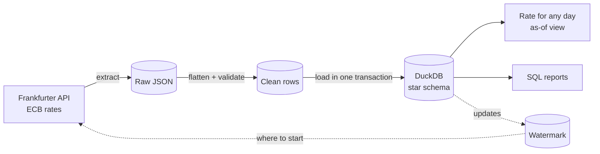
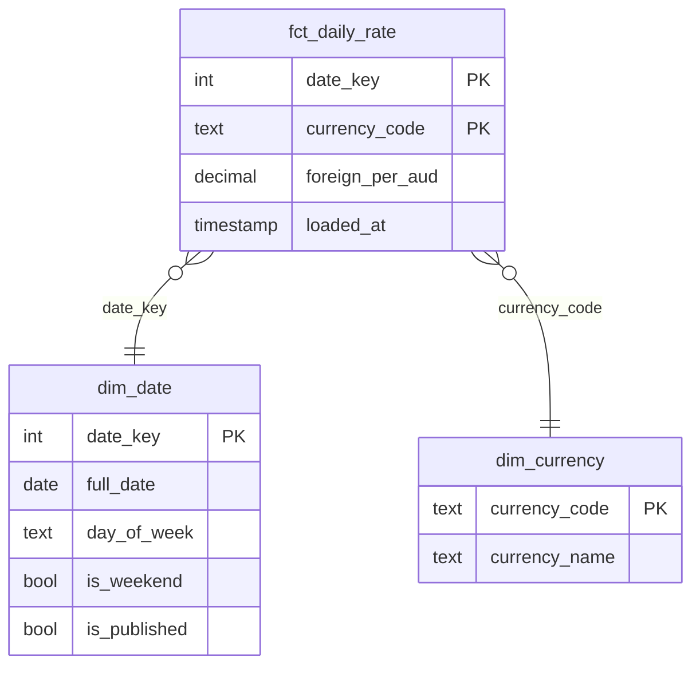

# Currency Exchange Pipeline

A small pipeline that keeps daily AUD exchange rates for USD, EUR, CNY and JPY up to date,
for an imaginary Melbourne importer that pays its suppliers in those currencies.

The interesting part isn't the data, it's the loading. The pipeline remembers how far it got
last time and only fetches what's new, so a daily run takes a few days of data instead of six
years. That memory is called a watermark, and most of the design decisions below are about
keeping it honest.

It's Project 2 in my data engineering practice series. Project 1 is
[weather-pipeline](https://github.com/sagameko/weather-pipeline).

## How it works



1. Read the watermark: the last date that was loaded successfully.
2. Fetch from three days before the watermark up to today. On the very first run, fetch all
   history from 2020.
3. Save the API response untouched, flatten it into one row per currency per day, and check it.
4. Load the dimensions, the facts and the new watermark inside a single transaction.

## The data model

One row in the fact table is **the rate of one currency on one day the ECB published rates**.



`foreign_per_aud` means 1 AUD buys this many units of the foreign currency. The direction is
in the name on purpose, because it's very easy to get backwards.

## What the data shows

From January 2020 to November 2026:

- **No weekday is a better day to pay.** The average USD per AUD ranges from 0.68616 (Friday)
  to 0.68724 (Wednesday), a difference of under 0.2% across about 350 days each.
- **The rate really moves.** A 10,000 USD invoice cost as little as 12,896 AUD (May 2021) and as
  much as 16,508 AUD (April 2020).
- **The biggest single-day moves line up with real events**, such as a 5.5% drop against the yen
  on 5 August 2024 during the carry-trade unwind, and AUD falling against all four currencies
  at once on 4 April 2025, after the US tariff announcement.

## Running it

You'll need [uv](https://docs.astral.sh/uv/).

```bash
git clone https://github.com/sagameko/currency-exchange.git
cd currency-exchange
uv sync

uv run fx-pipeline     # first run loads history from 2020; later runs only fetch new days
uv run fx-report       # print the five reports
uv run pytest          # run the tests
```

Currencies, the history start date and the lookback window live in `config/settings.yaml`.

## Decisions I made, and why

**The watermark is updated in the same transaction as the data.** If the watermark moved forward
and the load then failed, the next run would think those days were done, and they'd be missing
for good with nobody noticing. Keeping both in one transaction means they succeed or fail
together. A test simulates a failure halfway through and checks the watermark didn't move.

**Every run re-fetches the last three days.** Sources sometimes correct recent data. Re-fetching
a short window, then deleting and reloading that date range, picks up corrections without ever
creating duplicates.

**The fact table only holds days the ECB actually published.** Weekends and holidays have no row.
A view uses DuckDB's `ASOF JOIN` to give a rate for any calendar day, taken from the latest
published day, and it says which day the rate came from. If I filled the gaps inside the fact
table, day-over-day changes would show fake zeros every weekend and nobody could tell a real rate
from a borrowed one.

**Rates are never floats.** They're read from JSON straight into `Decimal` and stored as
`DECIMAL(18, 8)`. With floats, 0.1 + 0.2 isn't 0.3, and small errors add up across thousands of
invoice conversions.

**I don't trust the API to return what I asked for.** Two things I found while testing:
- Asking for rates from 1 January returns 31 December too, because 1 January is a holiday. The
  transform step drops anything outside the requested range; otherwise the December row would be
  loaded twice.
- Asking for a valid currency together with an invalid one returns HTTP 200 with no rates at all,
  instead of an error. The extract step now stops if any requested currency is missing, so a typo
  in the config can't quietly produce empty reports.

**Relationships are checked by queries, not foreign keys.** Like most analytical warehouses, the
schema doesn't use foreign keys. Instead, before each commit the pipeline checks that every fact
row has a matching date and currency, and that every published day has rates. If any check
fails, the load is rolled back.

## What I'd improve

- It only runs when I run it. Scheduling it daily is the next step (cron, then Airflow).
- If the source corrects a rate older than three days, the pipeline won't notice. A manual
  `--full-refresh` option would cover that.
- The ECB publishes one reference rate per day. A real treasury team would also want bank buy
  and sell rates, which this source doesn't have.

## Project layout

```
config/settings.yaml          currencies, history start date, lookback window
sql/ddl/create_tables.sql     star schema, watermark table and the as-of view
sql/reports/                  the five report queries
src/currency_exchange/
    extract/                  API client, retries, missing-currency check
    transform/                flattening, range filter, data quality checks
    load/                     dimensions, facts, watermark, integrity checks
    utils/dates.py            chooses which dates to load
    main.py                   runs the pipeline
    reports.py                prints the reports
tests/                        pytest suite (22 tests)
```
